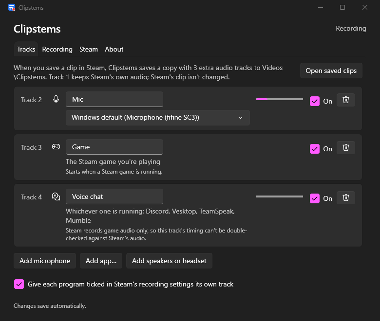

# Clipstems

Steam Game Recording saves clips with one audio track: game, mic and
Discord mixed together. You can't turn down your own voice or drop the
Discord call when you edit.

Clipstems runs next to Steam and records each source separately. When you
save a clip in Steam, it writes a copy of the clip as an MP4 with:

- track 1: Steam's own audio, unchanged (players that only use the first
  track still get the full mix)
- one more track each for your mic, the game, and any app you choose
  (Discord, for example)

The extra tracks are lined up with Steam's audio by cross-correlation, not
just by timestamps. Steam's clip is never modified.



## Status

Works on my machine, with daily use just starting. Steam's recording formats
are undocumented, so a Steam update can break clip reading. When that happens
Clipstems reports an error rather than writing a file with misaligned audio.

## Install

Download `ClipstemsApp-win-Setup.exe` from the
[latest release](https://github.com/Jmcasavant/clipstems/releases/latest) and
run it. It installs for your user only (no admin prompt), includes FFmpeg,
and keeps itself up to date. The installer isn't code-signed yet, so Windows
SmartScreen may warn: choose "More info", then "Run anyway".

Requirements:

- Windows 11, or Windows 10 build 20348 or later (per-app audio capture
  needs it)
- Steam with Game Recording turned on

Uninstall from Settings > Apps. That removes the program and its recorded
audio; your settings stay in `%LOCALAPPDATA%\Clipstems`.

## What it does

Once running, Clipstems sits in the tray. By default it:

- records while a Steam game is running, and stops 30 s after it exits
- records a Mic track (the Windows default input) and a Game track (the
  running Steam game's process tree)
- adds a track for each program ticked in Steam > Settings > Game Recording
  when "Record Audio from" is set to "Game and Selected Programs"
- writes clips to `Videos\Clipstems` and shows a notification for each one
- starts with Windows

Add more tracks in the settings window: another microphone, an app by
exe name (there is a preset that covers Discord, Vesktop, TeamSpeak and
Mumble), or a speaker or headset output. Every enabled track is in every
clip, silent where it had no audio, so track numbers stay the same from
clip to clip.

The tray icon shows when it is recording. Pause is in its menu.

## How it works

1. Each track is captured with WASAPI: the mic as a normal input, apps and
   the game with process loopback, which includes their child processes.
2. Audio goes into a rolling buffer of one-minute segments, kept for
   2 hours by default. Finished minutes are compressed to Opus, about
   1 MB per track per minute at most.
3. When Steam saves a clip, Clipstems reads the clip's start time from
   Steam's metadata, then cross-correlates Steam's audio against its own
   recording of everything you heard to find the exact offset.
4. Each track is cut to the clip and muxed with ffmpeg. Steam's video and
   audio are copied as they are; the extra tracks are AAC.

If the offset can't be confirmed (silence, or audio that matches in several
places), the file is still written using Steam's timestamp, and the
notification warns that the extra tracks may be up to about a second off. If the buffer has no audio for
the clip, no file is written. [docs/PLAN.md](docs/PLAN.md) has the
details and the measurements behind them.

## Limitations

- Clips that span more than one Steam recording session are refused.
- The game and app tracks need the game or app to play through Windows'
  normal audio path. Exclusive-mode audio isn't captured.
- Your mic track is raw. If Steam also records your mic, Steam's copy
  (track 1) goes through Steam's noise suppression and Clipstems' does
  not.
- A clip saved more than 2 hours after the moment it shows has no extra
  tracks unless you raise the buffer length.

## Command line

The CLI runs the same engine as the tray app. It isn't part of the
installer; run it from a source checkout:

```bash
dotnet run --project src/Clipstems.Cli -- doctor
```

| Command | Does |
|---|---|
| `doctor` | Checks Steam and its recording settings, the tracks to record, ffmpeg, the buffer and per-app capture |
| `watch` | Records and attaches tracks to each new clip, like the tray app |
| `clips` | Lists Steam clips and which buffered tracks cover them |
| `attach <clip folder or latest> [--tracks a,b] [--out dir]` | Writes the MP4 for one clip |
| `record [--track name=source]... [--when always\|game] [--seconds N]` | Records into the buffer only |
| `devices`, `apps` | List audio devices, and apps playing audio |
| `compact` | Compresses the buffer's finished minutes now |

Track sources for `--track`: `mic`, `mic:<device>`, `system`,
`system:<device>`, `app:<exe>[|<exe>...]`, `game`, `all`, `pid:<id>`.
For example: `--track voice=app:Discord.exe|Vesktop.exe`.

## Files

| What | Where |
|---|---|
| Output clips | `Videos\Clipstems` (changeable in settings) |
| Settings and logs | `%LOCALAPPDATA%\Clipstems` |
| Audio buffer | `%LOCALAPPDATA%\Clipstems\buffer`, or `CLIPSTEMS_BUFFER` |
| The installed app | `%LOCALAPPDATA%\ClipstemsApp` |

Clipstems reads Steam's files and never writes to them.

## Development

Building from source needs the
[.NET 10 SDK](https://dotnet.microsoft.com/download/dotnet/10.0), and ffmpeg on
`PATH` (for example `winget install Gyan.FFmpeg.Essentials`) or its path in
`CLIPSTEMS_FFMPEG`.

```bash
dotnet run --project src/Clipstems.App
```

```bash
dotnet test
```

The installer is built by `build/package.ps1`;
[docs/RELEASING.md](docs/RELEASING.md) covers releases.

[docs/APP.md](docs/APP.md) covers the app's design decisions and the
setups it handles.

## License

MIT. Clipstems is not affiliated with or endorsed by Valve. Steam is a
trademark of Valve Corporation.
